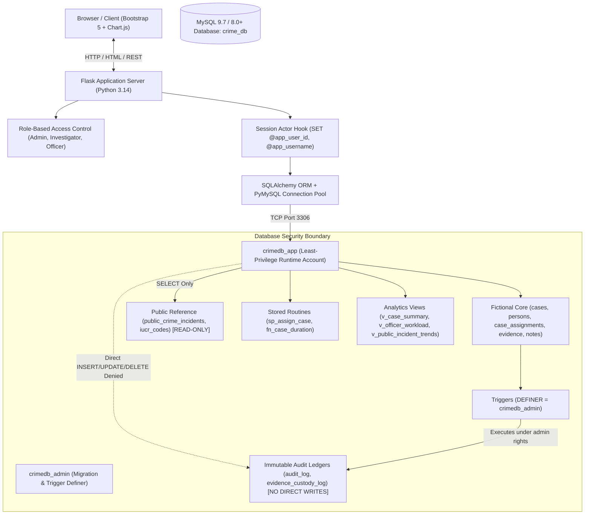

# Criminal Case Management & Crime Analytics System
**Enterprise Relational DBMS Project | Project Evaluation**

A complete, production-grade Relational Database Management System (DBMS) built with **MySQL 9.7 / 8.0+**, **Python 3.14**, **Flask**, **SQLAlchemy**, **PyMySQL**, **Bootstrap 5**, and **Chart.js**.

The application bridges **real-world public crime open data** (City of Chicago Socrata Open Data Portal) with **fictional law enforcement case management dossiers**, enforcing strict relational normalization (**Boyce-Codd Normal Form / BCNF**), declarative integrity constraints, database triggers, stored routines, indexing benchmarks, and a hardened least-privilege security model.

---

## 1. System Architecture & Tech Stack



### Core Technologies
- **Database:** MySQL Community Server 9.7.1 (InnoDB engine, utf8mb4 collation, BCNF schema).
- **Backend Framework:** Python 3.14, Flask 3.1.2, Flask-Login 0.6.3.
- **ORM / DB Driver:** SQLAlchemy 2.0.44, Flask-SQLAlchemy 3.1.1, PyMySQL 1.1.2.
- **Frontend:** Bootstrap 5.3.3, Bootstrap Icons 1.11.3, Chart.js 4.4.1 (Responsive UI).
- **Test Suite:** pytest 9.1.1 (35 automated unit & integration tests, 100% pass rate).

---

## 2. Relational Schema & BCNF Normalization

The database architecture comprises **14 normalized base tables**, strictly partitioned into three non-overlapping domains:

### Fictional Investigation Management Domain
1. `police_stations`: Certified precincts, command addresses, contact details.
2. `users`: Law enforcement personnel with salted password hashes, roles (`Admin`, `Investigator`, `Officer`), and security clearances (`PUBLIC`, `INTERNAL`, `CONFIDENTIAL`, `RESTRICTED`).
3. `cases`: Investigation dossiers with case numbers, types, priority levels, security classifications (`PUBLIC`, `INTERNAL`, `CONFIDENTIAL`, `RESTRICTED`), and closure consistency check constraints.
4. `persons`: Fictional suspects, witnesses, victims, and persons of interest (`is_fictional = TRUE` constraint).
5. `case_assignments`: Junction entity tracking officer allocations, active statuses, and assignment timestamps.
6. `case_persons`: Junction entity linking persons of interest to cases with involvement roles and statement summaries.
7. `evidence`: Physical and digital forensic items cataloged with storage locations and custody statuses.
8. `investigation_notes`: Confidential investigative logs and diary notes with investigator access controls.
9. `evidence_custody_log`: Append-only immutable chain-of-custody transfer ledger.
10. `audit_log`: System-wide immutable security audit log capturing state transitions.

### Public Crime Analytics Domain
11. `iucr_codes`: Canonical Illinois Uniform Crime Reporting lookup reference table (4-character primary key, FBI codes).
12. `public_crime_incidents`: Real Chicago open dataset records preserving original source fields (`source_primary_type`, `source_iucr_code`) alongside canonical foreign keys (`canonical_iucr_code`).

### Citizen Service & Reporting Domain (Isolated)
13. `citizens`: Registered public citizens with secure password hashes, contact details, and session isolation from police staff.
14. `citizen_reports`: Fictional non-emergency public incident submissions with collision-resistant tracking codes (`CR-YYYY-XXXXX`), status workflows, and public updates.

---

## 3. Multi-Level Security (MLS) & Clearance Access Model

The system implements a dual-layer security architecture combining **Bell-LaPadula Multilevel Security (MLS)** with **Discretionary Need-to-Know Verification**:

### Security Classification Hierarchy
```
Level 1: PUBLIC       — Routine public disclosures & non-sensitive records
Level 2: INTERNAL     — Standard patrol & precinct operational files
Level 3: CONFIDENTIAL — Detective division active investigations
Level 4: RESTRICTED   — Major crimes task force & executive command files
```

### Access Authorization Rules
1. **Bell-LaPadula Simple Security Property ("No Read Up"):**
   A user can only read a case dossier if their clearance rank is greater than or equal to the case's classification rank (`user.clearance >= case.classification`).
2. **Discretionary Need-to-Know:**
   For `CONFIDENTIAL` and `RESTRICTED` classified dossiers, having sufficient clearance is necessary but not sufficient. Personnel must also hold an **active operational assignment** (`case_assignments.is_active = TRUE`), be the original intake officer, or hold executive command administrator privileges.
3. **Database Query Filtering:**
   All case listings, evidence repositories, person participations, and dashboard KPIs/charts are filtered at the SQL query level (`filter_cases_for_user()`), preventing information leakage.
4. **Information Leakage Prevention:**
   Unauthorized access attempts trigger HTTP 403 Forbidden with custom security alert pages, and cross-citizen access attempts trigger HTTP 404 to prevent resource enumeration.

---

## 4. Citizen Portal & Public Reporting

Accessible via `/citizen/` routes, providing complete non-emergency reporting services:
- **Registration & Authentication:** `/citizen/register`, `/citizen/login`, `/citizen/logout`.
- **Public Dashboard:** `/citizen/dashboard` displaying status metrics and submitted incident tracking cards.
- **Incident Reporting:** `/citizen/reports/new` generating tracking references (e.g. `CR-2026-00001`).
- **Tracking & Public Updates:** `/citizen/reports/<id>` presenting public-facing notes from community liaison staff.
- **Strict Privacy Isolation:** Citizen A cannot view Citizen B's reports (HTTP 404). Citizen sessions cannot access internal police staff routes (`/cases`, `/evidence`, `/dashboard`).
- **Demo Credentials:** `citizen.jane@example.com` / `Citizen123!`.

---

## 3. Security & Privilege Model

The system enforces enterprise database security through a **Dual MySQL Account Architecture**:

| Account | Host | Intended Purpose | Privileges Granted | Prohibited Actions |
| :--- | :--- | :--- | :--- | :--- |
| `crimedb_admin` | `localhost` | Schema migration, trigger definer, batch ingestion | DDL (`CREATE`, `ALTER`, `DROP`), DML, `TRIGGER`, `EXECUTE` | Not used for web application runtime |
| `crimedb_app` | `localhost` | Flask web application runtime connection | `SELECT`, `INSERT`, `UPDATE`, `DELETE` on operational tables; `SELECT` on views/reference; `EXECUTE` on routines | Cannot write to `audit_log` or `evidence_custody_log`; cannot modify public crime tables; no DDL |

### Trigger Definer Security & Dynamic Context
To prevent malicious tampering while ensuring accountability:
1. `audit_log` and `evidence_custody_log` deny direct `INSERT`, `UPDATE`, and `DELETE` to the `crimedb_app` account.
2. Database triggers (`trg_evidence_initial_custody`, `trg_evidence_custody_update`, `trg_cases_status_audit`) are created with `DEFINER = 'crimedb_admin'@'localhost'`.
3. In Flask, an `@app.before_request` hook executes:
   ```sql
   SET @app_user_id = :uid, @app_username = :uname;
   ```
   Triggers read `@app_user_id` and `@app_username` dynamically. If no user is authenticated, `NULL` is recorded. User identity is never fabricated or hard-coded.

---

## 4. Quickstart Guide (Windows PowerShell)

### Prerequisites
- Python 3.10+ (tested on Python 3.14.0)
- MySQL Community Server 8.0+ or 9.x (running on `localhost:3306`)

### Step 1: Install Dependencies
Open PowerShell in `D:\Criminal Database`:
```powershell
pip install -r requirements.txt
```

### Step 2: Configure Environment Variables
Verify or edit `.env` in the project root:
```ini
# Flask Configuration
SECRET_KEY=crime-analytics-secret-key-2026-prod-grade
FLASK_APP=run.py
FLASK_ENV=development

# MySQL Database Settings
DB_HOST=127.0.0.1
DB_PORT=3306
DB_NAME=crime_db

# Runtime Application Account (Least-Privilege)
DB_USER=crimedb_app
DB_PASSWORD=AppSecurePass123!

# Administrative Migration Account
DB_ADMIN_USER=crimedb_admin
DB_ADMIN_PASSWORD=AdminSecurePass123!
```

### Step 3: Run Database Migrations (If setting up fresh)
```powershell
python scripts/execute_sql_scripts.py
```

### Step 4: Run the Web Application
```powershell
python run.py
```
Open your browser and navigate to: **`http://127.0.0.1:5000`**

---

## 5. Demo Credentials

The database is pre-seeded with 7 fictional law enforcement personnel accounts across three RBAC roles (all passwords are set to `DemoPass123!`):

| Username | Role | Full Name | Badge # | Permissions & Access Scope |
| :--- | :--- | :--- | :--- | :--- |
| `admin_sys` | **Admin** | Chief Eleanor Vance | B-001 | Full administrative access, case deletion, SQL demo showcase, user management |
| `investigator_chen` | **Investigator** | Senior Det. Marcus Chen | B-104 | Case creation & editing, confidential investigative diary notes, evidence cataloging |
| `investigator_ramirez`| **Investigator** | Det. Sofia Ramirez | B-118 | Case editing, evidence transfers, persona dossiers |
| `officer_carter` | **Officer** | Patrol Officer Liam Carter | B-205 | View cases, create initial dossiers, read-only analytics (case deletion prohibited) |
| `officer_patel` | **Officer** | Patrol Officer Priya Patel | B-212 | View cases, catalog field evidence, public analytics |

---

## 6. Running Automated Tests

A comprehensive suite of 35 automated test cases covers authentication, RBAC, Multi-Level Security (MLS) clearance hierarchy, Bell-LaPadula access rules, Need-to-Know authorization, Citizen Portal registration and reporting, cross-citizen privacy isolation, CRUD workflows, repeatability of the Chicago API importer, stored procedures, stored functions, and trigger audit logging.

Run the test suite with pytest:
```powershell
python -m pytest -v
```

### Test Suite Execution Summary
```
tests/test_auth.py::test_unauthenticated_redirect PASSED                 [  2%]
tests/test_auth.py::test_valid_admin_login PASSED                        [  5%]
tests/test_auth.py::test_invalid_password PASSED                         [  8%]
tests/test_auth.py::test_logout PASSED                                   [ 11%]
tests/test_cases_crud.py::test_list_cases_filter PASSED                  [ 14%]
tests/test_cases_crud.py::test_create_case_validation PASSED             [ 17%]
tests/test_cases_crud.py::test_create_and_read_case PASSED               [ 20%]
tests/test_citizen_portal.py::test_unauthenticated_citizen_redirect PASSED [ 22%]
tests/test_citizen_portal.py::test_citizen_registration_and_login PASSED [ 25%]
tests/test_citizen_portal.py::test_citizen_login_invalid_password PASSED [ 28%]
tests/test_citizen_portal.py::test_citizen_report_submission_and_tracking PASSED [ 31%]
tests/test_citizen_portal.py::test_cross_citizen_privacy_isolation PASSED [ 34%]
tests/test_citizen_portal.py::test_citizen_session_cannot_access_staff_routes PASSED [ 37%]
tests/test_classification_security.py::test_clearance_rank_hierarchy PASSED [ 40%]
tests/test_classification_security.py::test_admin_restricted_case_access PASSED [ 42%]
tests/test_classification_security.py::test_investigator_cannot_access_restricted_case PASSED [ 45%]
tests/test_classification_security.py::test_officer_cannot_access_confidential_case PASSED [ 48%]
tests/test_classification_security.py::test_assigned_investigator_accesses_confidential_case PASSED [ 51%]
tests/test_classification_security.py::test_unassigned_investigator_denied_need_to_know PASSED [ 54%]
tests/test_classification_security.py::test_deactivated_user_blocked_from_all_cases PASSED [ 57%]
tests/test_classification_security.py::test_dashboard_query_isolation PASSED [ 60%]
tests/test_classification_security.py::test_officer_forbidden_from_admin_staff PASSED [ 62%]
tests/test_classification_security.py::test_admin_staff_clearance_management PASSED [ 65%]
tests/test_importer.py::test_importer_repeatability PASSED               [ 68%]
tests/test_permissions.py::test_admin_access_allowed PASSED              [ 71%]
tests/test_permissions.py::test_officer_cannot_delete_case PASSED        [ 74%]
tests/test_permissions.py::test_investigator_confidential_notes PASSED   [ 77%]
tests/test_stored_routines.py::test_stored_function_duration PASSED      [ 80%]
tests/test_stored_routines.py::test_stored_procedure_assignment PASSED   [ 82%]
tests/test_triggers.py::test_case_status_audit_trigger PASSED            [ 85%]
tests/test_triggers.py::test_evidence_custody_transfer_trigger PASSED    [ 88%]
tests/test_views.py::test_case_summary_query PASSED                      [ 91%]
tests/test_views.py::test_case_summary_orm_model PASSED                  [ 94%]
tests/test_views.py::test_officer_workload_orm_model PASSED              [ 97%]
tests/test_views.py::test_sql_demo_views_tab_http PASSED                 [100%]

============================= 35 passed in 8.97s ==============================
```

---

## 7. Public Crime Ingestion CLI

The system includes an idempotent importer service connecting to the **City of Chicago Socrata Open Data API** (`ijzp-q8t2.json`). It performs canonical IUCR code reconciliation, batches inserts, and prevents duplicates:

```powershell
python scripts/import_chicago_data.py --limit 50
```

---

## 8. Advanced DBMS Demonstration Showcase (`/sql-demo`)

The interactive web showcase demonstrates all curriculum-mandated DBMS concepts with live query executions, execution times, and visual result grids:

1. **Analytical JOINs & Aggregations:** Multi-table JOIN linking cases, police stations, lead investigators, and evidence counts.
2. **Correlated Nested Subqueries:** Filtering stations whose active caseload exceeds the department-wide precinct average.
3. **Database Views:** Live queries on `v_case_summary`, `v_officer_workload`, and `v_public_incident_trends`.
4. **Stored Procedure (`sp_assign_case`):** Transactional procedure with exception handlers (`DECLARE EXIT HANDLER FOR SQLEXCEPTION`), concurrency isolation, single-lead-investigator enforcement, and status advancement.
5. **Stored Function (`fn_case_duration`):** Calculates elapsed case lifespan in days (`DATEDIFF(COALESCE(date_closed, NOW()), date_opened)`).
6. **Database Triggers:** Immutable audit trail in `audit_log` and `evidence_custody_log`.
7. **Query Optimization & EXPLAIN Plans:** Side-by-side comparative EXPLAIN cost analysis showing full table scans (`ALL`) converted to index range lookups (`ref` / `range`) via secondary composite indexes.
8. **ACID Transactions & Rollback:** Demonstrates atomicity where invalid operations trigger automatic `ROLLBACK` to preserve consistency.
