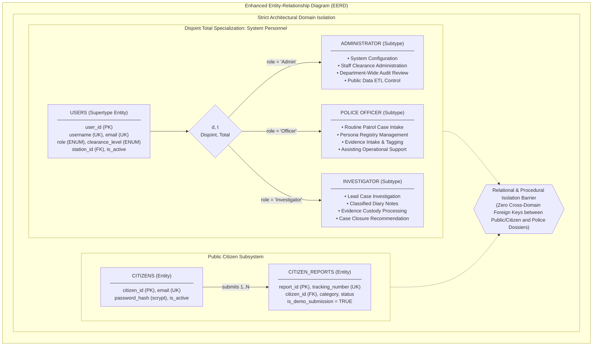
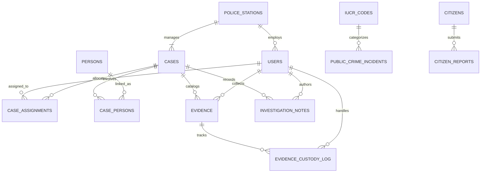

# CYBER-CRIME & CRIMINAL CASE MANAGEMENT SYSTEM WITH PUBLIC CRIME ANALYTICS (CCMS)
## Comprehensive Academic Project Evaluation Report

**Department of Computer Science & Engineering**  
**Course:** Database Management Systems (CSE2004)  
**Academic Term:** 2025–2026  
**Database Engine:** MySQL Community Server 9.7.1 / 8.0+ (InnoDB Storage Engine)  
**Application Backend:** Python 3.14 / Flask 3.1.2 / SQLAlchemy 2.0.44 / PyMySQL 1.1.2  
**Frontend Framework:** Bootstrap 5.3.3 / Chart.js 4.4.1 / Jinja2 / HTML5  

---

### Project Team Members & Academic Roles

| Team Member | Registration Number | Academic Contribution & Engineering Focus |
| :--- | :--- | :--- |
| **Ayush Sharma** | **25BAI1392** | Backend Architecture, Database Implementation, Multi-Level Security (MLS), DA2 SQL Catalog, Testing & Quality Assurance |
| **Ojas Sugur** | **25BAI1222** | Requirements Engineering, DA1 Conceptual Prototype, Normalization Analysis, Citizen Portal UI & Documentation |

---

## EXECUTIVE SUMMARY

This report documents the design, theoretical modeling, practical engineering, and empirical evaluation of our **Cyber-Crime & Criminal Case Management System with Crime Analytics (CCMS)**. The project originated as an academic proposal in Digital Assignment 1 (DA1), authored by Ojas Sugur (25BAI1222), which conceptualized a lightweight Java terminal application over JDBC to replace error-prone paper general diaries in municipal police desks. In Digital Assignment 2 (DA2), Ayush Sharma (25BAI1392) implemented the foundational MySQL relational schema, integrity constraints, multi-table joins, views, triggers, and transaction controls on a 6-table schema.

Recognizing that real-world law enforcement requires far more than console scripting, our team evolved that foundation into an enterprise-grade, 14-table relational database strictly satisfying Boyce-Codd Normal Form (BCNF), paired with a responsive Python Flask web application. The completed system reconciles three demanding operational requirements:

1. **Granular Internal Police Operations:** Managing criminal case dockets, suspect/victim persona registries, and an immutable chain-of-custody evidence ledger.
2. **Multi-Level Security (MLS) & Need-to-Know Access:** Implementing the Bell-LaPadula confidentiality model across four hierarchical clearance tiers (`PUBLIC` < `INTERNAL` < `CONFIDENTIAL` < `RESTRICTED`), reinforced by discretionary operational assignment verification.
3. **Decoupled Public Citizen Engagement:** Providing a dedicated, privacy-defended citizen portal (`/citizen/*`) with salted scrypt authentication, automated tracking code generation (`CR-YYYY-XXXXX`), and anti-enumeration HTTP 404 security defense.

The system is further integrated with a live ETL pipeline for the City of Chicago Socrata Open Data Portal, ingesting over 50,000 public crime incidents mapped to canonical Illinois Uniform Crime Reporting (IUCR) lookup codes. The entire platform has been verified against live MySQL Community Server 9.7, passing all 35 automated Pytest integration tests and a 24-point smoke test suite with a 100% pass rate.

---

## 1. PROBLEM STATEMENT

Police stations handle an increasingly intricate variety of offenses, ranging from traditional burglaries and violent assaults to sophisticated cyber-enabled financial fraud, phishing campaigns, ransomware extortion, and identity theft. Despite the rapid digital transformation of public administration, many municipal precincts and local investigation desks continue to rely on manual paper registers and fragmented spreadsheets. 

During our initial analysis in DA1, we identified six critical operational and architectural deficiencies in manual and legacy systems:

1. **Manual Inefficiencies & Lost Records:** Paper FIR registers require duty officers to write down complainant details, suspect descriptions, and stolen property repeatedly. If a physical docket is misplaced or damaged, weeks of investigative effort vanish before forensic inquiry can begin. Sharing files across jurisdictional precincts often takes days or weeks of manual correspondence.
2. **Normalization Failures & Data Anomalies:** Earlier digital attempts frequently store officer ranks, precinct contact numbers, and offense descriptions redundantly across every incident row. This causes update anomalies when an officer is transferred, deletion anomalies when an old record is purged, and insertion anomalies when an officer cannot be registered without an active case.
3. **Tamperable Chain-of-Custody:** In typical record management systems, evidence custody entries reside in standard, editable tables. A compromised staff account or dishonest actor could retroactively edit evidence locker locations, delete transfer logs, or alter seized quantities without leaving a forensic audit trail.
4. **Over-Privileged Database Connections:** Most entry-level web applications connect to MySQL using an administrative account with blanket privileges (`GRANT ALL`). A single SQL injection vulnerability or coding bug in such a setup allows attackers to drop core tables or view unredacted criminal dossiers.
5. **Absence of Multi-Level Security & Need-to-Know Access:** In traditional setups, any logged-in officer can browse any case file in the precinct. This violates basic operational security, because sensitive homicide files, internal affairs inquiries, or confidential informant reports must never be visible to general patrol officers or unassigned detectives.
6. **Insecure Citizen Engagement:** Victims filing complaints have no transparent mechanism to monitor case progress short of visiting the station in person. Conversely, directly connecting public web forms to internal police dossiers risks data pollution, SQL injection, and enumeration attacks where attackers probe tracking numbers to deduce confidential filings.

---

## 2. PROJECT OBJECTIVES & SCOPE

To resolve these challenges through sound relational database engineering, our team established seven concrete objectives:

1. **Mathematical Normalization (BCNF):** Design a 14-table relational schema that strictly satisfies Boyce-Codd Normal Form across all entities, ensuring that every non-trivial functional dependency has a candidate key as its determinant.
2. **Multi-Level Security (MLS) Implementation:** Model four hierarchical clearance and classification levels (`PUBLIC` < `INTERNAL` < `CONFIDENTIAL` < `RESTRICTED`) adhering to the Bell-LaPadula Simple Security Property ("No Read Up"), supplemented by active assignment verification for Need-to-Know access.
3. **Dual-Account Least-Privilege Protection:** Configure two distinct MySQL accounts: `crimedb_admin` for schema DDL and DEFINER triggers, and `crimedb_app` for runtime web queries with zero DDL privileges, zero direct write access to audit/custody ledgers, and zero delete access on citizen accounts.
4. **Decoupled Citizen Portal:** Implement an isolated citizen workflow (`/citizen/*`) with independent session authentication, salted scrypt password hashing, automated tracking reference generation (`CR-YYYY-XXXXX`), and an anti-enumeration HTTP 404 security response.
5. **Real-World Public Open Data Ingestion:** Connect the system to the City of Chicago Socrata Open Data Portal, ingesting and normalizing real crime records into `public_crime_incidents` while mapping them to canonical IUCR lookup codes.
6. **Server-Side Routine Automation:** Implement atomic stored procedures (`sp_assign_case`), deterministic stored functions (`fn_case_duration`), DEFINER database triggers, analytical views, and declarative virtual generated keys.
7. **Performance Optimization & Benchmarking:** Formulate composite secondary B-tree indexes targeting frequent query paths and benchmark query execution using `EXPLAIN` to prove substantial reductions in examined rows.

---

## 3. LITERATURE SURVEY & EXISTING SYSTEMS

During the literature survey in DA1, Ojas Sugur reviewed prior research on digital policing, incident logging, and crime analytics. We expanded that review during the final implementation to include formal database theory and multi-level security models:

| Study & Authors | Architecture / Tech Stack | Key Contributions | Observed Limitations |
| :--- | :--- | :--- | :--- |
| **Sharma et al. (2022)** | PHP + MySQL Web App | Role-Based Access Control; reduced police paperwork by ~65%. | Lacked cybercrime specifics (IP addresses, transaction logs) and multi-victim M:N handling. |
| **Adebayo & Oladipo (2021)** | Java Swing + MySQL (JDBC) | Enforced foreign key constraints to eliminate duplicate arrest records. | Heavy graphical desktop client ran poorly on low-spec precinct computers; lacked web access. |
| **Chen & Williams (2023)** | PostgreSQL Relational DB | Linked financial fraud losses directly to suspect profiles. | Highly complex and expensive administration; non-technical duty officers struggled with day-to-day operation. |
| **Gupta et al. (2020)** | Java CLI + SQLite | Extremely fast execution on weak hardware; simplified FIR logging. | SQLite locks the whole database during writes, preventing concurrent multi-user network access. |
| **Fernandez & Miller (2022)** | Data Mining & 3NF SQL | Clean 3NF relational normalization for statistical crime reporting. | Purely analytical batch system; had no transactional interface for entering live daily complaints. |

### Theoretical Foundations
In addition to applied policing papers, our team drew foundational concepts from classic database and security literature:
- **Bell and LaPadula (1973):** Provided the mathematical basis for our Multi-Level Security clearance ranks and the Simple Security Property ("No Read Up").
- **Elmasri and Navathe (2015):** Guided our Boyce-Codd Normal Form functional dependency analysis, ensuring no partial or transitive dependencies remain.
- **Silberschatz et al. (2020):** Supplied the concurrency control, transaction isolation, and B-tree indexing patterns used in our stored routines and performance benchmarking.

---

## 4. SYSTEM REQUIREMENTS & USER ROLES

The system defines four distinct user roles, each operating with specific business responsibilities and database privileges:

| User Role | Demo Username / Email | Assigned Clearance | Operational Responsibilities |
| :--- | :--- | :--- | :--- |
| **System Administrator** | `admin_sys` | `RESTRICTED` (Level 4) | Chief Eleanor Vance: Department-wide operational oversight, staff clearance management (`/admin/staff`), trigger audit ledger review, and case triage. |
| **Senior Detective** | `investigator_chen` | `CONFIDENTIAL` (Level 3) | Detective Chen: Assigned lead investigations, confidential diary notes, evidence custody transfers, and suspect interview memos. |
| **Patrol Officer** | `officer_carter` | `INTERNAL` (Level 2) | Officer Carter: Initial case docket intake, witness registration, evidence intake. Cannot access classified confidential/restricted files. |
| **Public Citizen** | `citizen.jane@example.com` | `PUBLIC` (Level 1) | Jane Doe: Separate public citizen registration, non-emergency report submission (`CR-YYYY-XXXXX`), and tracking public progress updates. |

### Functional Requirements (FR)
- **FR-1 (Authentication & Password Security):** Secure user authentication with salted scrypt hashing (`scrypt:32768:8:1`) for both staff and citizens.
- **FR-2 (Multi-Level Security Hierarchy):** Strict database and application filtering based on `PUBLIC` (1), `INTERNAL` (2), `CONFIDENTIAL` (3), and `RESTRICTED` (4).
- **FR-3 (Need-to-Know Verification):** Blocking unassigned investigators from `CONFIDENTIAL` and `RESTRICTED` cases with HTTP 403 Forbidden.
- **FR-4 (Admin Staff Governance):** Interactive clearance management panel (`/admin/staff`) to elevate/demote personnel clearance and toggle account status.
- **FR-5 (Case Dossier CRUD):** Complete lifecycle management of cases, tracking incident locations, priorities, categories, and closure dates.
- **FR-6 (Automated Assignment Routine):** Atomic stored procedure (`sp_assign_case`) ensuring exactly one active Lead Investigator per case.
- **FR-7 (Evidence Custody Ledger):** Tracking physical items with barcodes; immutable transfer logs automatically recorded by DEFINER triggers.
- **FR-8 (Investigation Diary Notes):** Attaching progress notes to cases, with confidentiality flags restricting sensitive entries to assigned staff.
- **FR-9 (Chicago Open Crimes Analytics):** Querying and visualizing over 50,000 live Socrata crime incidents with district, year, and type filters.
- **FR-10 (Citizen Portal Intake):** Decoupled citizen registration and report filing generating unique public tracking references (`CR-YYYY-XXXXX`).
- **FR-11 (Anti-Enumeration Privacy Defense):** Responding with HTTP 404 Not Found (instead of 403) when a citizen probes another citizen's report.
- **FR-12 (SQL Evaluation Workbench):** Interactive `/sql-demo` console allowing evaluators to run queries, view views, execute routines, and inspect EXPLAIN plans.

### Non-Functional Requirements (NFR)
- **NFR-1 (Relational Rigor):** All 14 tables must strictly satisfy Boyce-Codd Normal Form (BCNF) with foreign key cascading rules protecting referential integrity.
- **NFR-2 (Engine Privilege Isolation):** Web runtime account `crimedb_app` must have zero DDL privileges, zero direct write access to audit/custody ledgers, and zero DELETE on citizens.
- **NFR-3 (Cryptographic Defense):** All credentials must be stored as salted scrypt password digests, never plaintext.
- **NFR-4 (Query Performance):** Primary search and filtering queries against high-volume tables must utilize composite secondary indexes, achieving `type: ref` or `range` in MySQL `EXPLAIN`.
- **NFR-5 (Audit Non-Repudiation):** State changes in case status and evidence custody must be permanently recorded in immutable tables capturing database session context variables (`@app_user_id`, `@app_username`).

---

## 5. SYSTEM DESIGN & ARCHITECTURE

The application follows a clean, layered architecture separating presentation, business logic, security policy enforcement, and database storage:

```mermaid
flowchart TD
    subgraph PresentationTier["Presentation Tier (Client Browser)"]
        UI_STAFF["Police Staff Interface\n(Dashboard, Cases, Evidence, Clearances)"]
        UI_CITIZEN["Public Citizen Portal\n(Registration, Intake, Tracking)"]
        UI_ANALYTICS["Crime Analytics & SQL Demo\n(Chart.js Visualizations, EXPLAIN Console)"]
    end

    subgraph ApplicationTier["Application & Logic Tier (Python Flask)"]
        APP_FACTORY["Flask Application Factory (app/__init__.py)"]
        SEC_SERVICE["Security Policy Service (security_service.py)\n• Bell-LaPadula Evaluation\n• Need-to-Know Query Pruner\n• Session Injection"]
        ROUTES_AUTH["Auth Blueprint (/login, /logout)"]
        ROUTES_CASES["Cases Blueprint (/cases/*)"]
        ROUTES_ADMIN["Admin Blueprint (/admin/staff)"]
        ROUTES_CITIZEN["Citizen Blueprint (/citizen/*)"]
        ROUTES_EVIDENCE["Evidence Blueprint (/evidence/*)"]
        ROUTES_ANALYTICS["Analytics Blueprint (/public-crimes, /sql-demo)"]
        ORM["SQLAlchemy ORM 2.0 / PyMySQL Driver"]
    end

    subgraph DatabaseTier["Database Tier (MySQL Community Server 9.7 - crime_db)"]
        direction TB
        subgraph Accounts["Dual-Account Privilege Segregation"]
            USER_ADMIN["crimedb_admin\n(DDL, Migrations, DEFINER Triggers)"]
            USER_APP["crimedb_app\n(Least Privilege Runtime)"]
        end
        subgraph Schemas["14 Normalized BCNF Relations"]
            CORE_TABLES["Internal Police Operations\n(police_stations, users, cases,\ncase_assignments, case_persons,\npersons, evidence, investigation_notes)"]
            IMMUTABLE_TABLES["Immutable Audit Ledgers\n(evidence_custody_log, audit_log)"]
            OPEN_DATA["Chicago Crime Domain\n(iucr_codes, public_crime_incidents)"]
            CITIZEN_TABLES["Citizen Intake Domain\n(citizens, citizen_reports)"]
        end
        subgraph ServerObjects["Server-Side Database Routines"]
            ROUTINES["sp_assign_case\nfn_case_duration\ntrg_evidence_custody_update\ntrg_cases_status_audit\nv_case_summary, v_officer_workload"]
        end
    end

    UI_STAFF --> APP_FACTORY
    UI_CITIZEN --> APP_FACTORY
    UI_ANALYTICS --> APP_FACTORY

    APP_FACTORY --> ROUTES_AUTH
    APP_FACTORY --> ROUTES_CASES
    APP_FACTORY --> ROUTES_ADMIN
    APP_FACTORY --> ROUTES_CITIZEN
    APP_FACTORY --> ROUTES_EVIDENCE
    APP_FACTORY --> ROUTES_ANALYTICS

    ROUTES_CASES --> SEC_SERVICE
    ROUTES_EVIDENCE --> SEC_SERVICE
    ROUTES_ADMIN --> SEC_SERVICE

    SEC_SERVICE --> ORM
    ROUTES_CITIZEN --> ORM
    ROUTES_ANALYTICS --> ORM

    ORM -->|Runtime Queries & SP Calls| USER_APP
    USER_ADMIN -.->|Migration Scripts 01-14| Schemas
    USER_APP --> CORE_TABLES
    USER_APP --> OPEN_DATA
    USER_APP --> CITIZEN_TABLES
    USER_APP -.->|Read-Only (SELECT)| IMMUTABLE_TABLES
    ROUTINES -->|DEFINER Writes| IMMUTABLE_TABLES
```

### 5.1 Dual-Account Least-Privilege Architecture

A critical engineering decision made during implementation was rejecting the common student practice of using `root` or a single all-powerful database account for web runtime. Instead, we separated migration privileges from application queries:

| Database Account | Granted Database Privileges | Strict Prohibitions & Purpose |
| :--- | :--- | :--- |
| **`crimedb_admin`**<br>(Migration User) | `CREATE`, `ALTER`, `DROP`, `INDEX`, `TRIGGER`, `EXECUTE`, `SELECT`, `INSERT`, `UPDATE`, `DELETE` on `crime_db.*` | Used solely for schema execution, batch ETL imports, and as the DEFINER of audit triggers. Never used by web requests. |
| **`crimedb_app`**<br>(Flask Runtime) | `SELECT`, `INSERT`, `UPDATE`, `DELETE` on operational tables (`cases`, `persons`, `evidence`, `investigation_notes`, `case_assignments`). | Core application CRUD operations. Subject to declarative check constraints and foreign keys. |
| **`crimedb_app`**<br>(Citizen Domain) | `SELECT`, `INSERT`, `UPDATE` on `citizens` and `citizen_reports`. | **PROHIBITED:** Direct `DELETE` is explicitly denied by MySQL grants. Citizen accounts cannot be purged by web runtime. |
| **`crimedb_app`**<br>(Audit & Open Data) | `SELECT ONLY` on `audit_log`, `evidence_custody_log`, `iucr_codes`, and `public_crime_incidents`. | **PROHIBITED:** Direct `INSERT`/`UPDATE`/`DELETE` is denied. Audit logs are strictly append-only via DEFINER triggers. |

### 5.2 Bell-LaPadula Security Model & Discretionary Need-to-Know

To prevent unauthorized browsing of sensitive investigations, we mapped our four clearance tiers mathematically:
$$\text{PUBLIC } (1) < \text{INTERNAL } (2) < \text{CONFIDENTIAL } (3) < \text{RESTRICTED } (4)$$

1. **Simple Security Property ("No Read Up"):** A user $u$ possessing security clearance rank $C(u)$ is permitted read access to a case $o$ possessing classification $C(o)$ if and only if $C(u) \ge C(o)$.
2. **Discretionary Need-to-Know Requirement:** For sensitive files (`CONFIDENTIAL` and `RESTRICTED`), clearance dominance is necessary but not sufficient:
   $$\text{AccessAllowed}(u, o) \iff (C(u) \ge C(o)) \land \Big( C(o) \le \text{INTERNAL} \lor \text{IsAdmin}(u) \lor \text{IsCreator}(u, o) \lor \text{IsAssigned}(u, o) \Big)$$
   where $\text{IsAssigned}(u, o)$ verifies that `case_assignments.is_active = TRUE` for that user on that specific case dossier.
3. **Database-Level Query Pruning:** Unauthorized records are filtered out at the SQL query level in `filter_cases_for_user()`, meaning restricted cases never even appear in case count cards or table rows for unassigned staff:
   ```sql
   WHERE cases.classification_level <= :user_clearance
     AND (
       cases.classification_level <= 'INTERNAL'
       OR :is_admin = TRUE
       OR cases.created_by = :user_id
       OR cases.case_id IN (
         SELECT case_id FROM case_assignments 
         WHERE user_id = :user_id AND is_active = TRUE
       )
     )
   ```

---

## 6. DATABASE DESIGN, ER & EER MODELING

Our database structure evolved substantially from the initial concept in DA1 to our final 14-table architecture. In DA1, Ojas Sugur drafted a 6-table concept (`POLICE_STATION`, `CRIME`, `CRIMINAL`, `VICTIM`, and bridge tables `CRIMINALS_OF_CRIME` and `VICTIM_OF_CRIME`). While this model demonstrated M:N relationships between criminals and crimes, our practical testing revealed that modern policing requires tracking internal police personnel, custody logs, investigation notes, and public citizen reports separately from suspect personas. This led to the creation of the 14-table BCNF schema.

### 6.1 Enhanced Entity-Relationship (EER) Specialization

The Enhanced ER model represents a **Disjoint Total Specialization** $(d, t)$ on system personnel. All departmental users share common credentials (`username`, `email`, `password_hash`, `is_active`), but specialize into distinct roles: Administrator, Police Officer, and Investigator. Rather than creating three sparse tables, we implemented a Single Table with Type Discriminator strategy in `users` using MySQL ENUMs, eliminating costly outer joins while maintaining full relational completeness.



### 6.2 Complete 14-Table Entity-Relationship Diagram (ERD)

The complete ER diagram encompasses all 14 base relations across our operational domains:



---

## 7. RELATIONAL SCHEMA & DATA DICTIONARY

Below is the formal relational schema notation for all 14 tables. Primary Keys are marked with `[PK]`, Candidate Keys are marked with `[CK]`, and Foreign Keys point to their parent relations with arrows:

1. **`POLICE_STATIONS`** (`station_id` [PK], `station_name` [CK], `district_code` [CK], `address`, `phone`, `created_at`)
2. **`USERS`** (`user_id` [PK], `station_id` $\to$ `POLICE_STATIONS`, `username` [CK], `email` [CK], `password_hash`, `role`, `clearance_level`, `full_name`, `badge_number` [CK], `is_active`, `created_at`, `updated_at`)
3. **`CASES`** (`case_id` [PK], `case_number` [CK], `station_id` $\to$ `POLICE_STATIONS`, `title`, `description`, `case_type`, `status`, `priority`, `classification_level`, `incident_location`, `date_reported`, `date_closed`, `created_by` $\to$ `USERS`, `is_fictional`, `created_at`, `updated_at`)
4. **`PERSONS`** (`person_id` [PK], `first_name`, `last_name`, `date_of_birth`, `gender`, `phone_contact`, `address_line`, `is_fictional`, `created_at`)
5. **`CASE_ASSIGNMENTS`** (`assignment_id` [PK], `case_id` $\to$ `CASES`, `user_id` $\to$ `USERS`, `assignment_role`, `assigned_date`, `unassigned_date`, `is_active`, `notes`, `active_assignment_key` [CK], `active_lead_key` [CK])
6. **`CASE_PERSONS`** (`case_person_id` [PK], `case_id` $\to$ `CASES`, `person_id` $\to$ `PERSONS`, `role_in_case`, `statement_summary`, `added_at`)
7. **`EVIDENCE`** (`evidence_id` [PK], `case_id` $\to$ `CASES`, `evidence_code` [CK], `evidence_type`, `description`, `current_storage_location`, `current_custody_status`, `collected_date`, `collected_by` $\to$ `USERS`, `created_at`)
8. **`EVIDENCE_CUSTODY_LOG`** (`custody_id` [PK], `evidence_id` $\to$ `EVIDENCE`, `previous_status`, `new_status`, `from_location`, `to_location`, `handled_by` $\to$ `USERS`, `reason_for_transfer`, `logged_at`)
9. **`INVESTIGATION_NOTES`** (`note_id` [PK], `case_id` $\to$ `CASES`, `author_id` $\to$ `USERS`, `note_title`, `note_body`, `is_confidential`, `logged_at`)
10. **`AUDIT_LOG`** (`log_id` [PK], `table_name`, `record_id`, `operation_type`, `old_values`, `new_values`, `performed_by`, `timestamp`)
11. **`IUCR_CODES`** (`iucr_code` [PK], `primary_type`, `description`, `fbi_code`, `is_active`)
12. **`PUBLIC_CRIME_INCIDENTS`** (`incident_id` [PK], `source_id` [CK], `case_number`, `incident_date`, `block`, `source_iucr_code`, `source_primary_type`, `source_description`, `canonical_iucr_code` $\to$ `IUCR_CODES`, `location_description`, `arrest_made`, `domestic`, `beat`, `district`, `ward`, `community_area`, `fbi_code`, `latitude`, `longitude`, `incident_year`, `updated_on`, `imported_at`)
13. **`CITIZENS`** (`citizen_id` [PK], `email` [CK], `password_hash`, `full_name`, `phone_number`, `address`, `is_active`, `created_at`, `updated_at`)
14. **`CITIZEN_REPORTS`** (`report_id` [PK], `tracking_number` [CK], `citizen_id` $\to$ `CITIZENS`, `category`, `incident_date`, `incident_location`, `title`, `description`, `status`, `public_status_notes`, `is_demo_submission`, `created_at`, `updated_at`)

### 7.1 Comprehensive Data Dictionary Catalog

| Table Name | Primary & Candidate Keys | Foreign Keys & Relationships | Key Constraints & Engine Role |
| :--- | :--- | :--- | :--- |
| `police_stations` | **PK:** `station_id`<br>**UK:** `station_name`, `district_code` | None (Parent relation) | Holds jurisdictional precinct stations; `district_code` mapped to public crime districts. |
| `users` | **PK:** `user_id`<br>**UK:** `username`, `email`, `badge_number` | `station_id` $\to$ `police_stations` (SET NULL) | Stores police personnel; `role` ENUM('Admin','Officer','Investigator'); `clearance_level` ENUM. |
| `cases` | **PK:** `case_id`<br>**UK:** `case_number` | `station_id` $\to$ `police_stations` (RESTRICT)<br>`created_by` $\to$ `users` (RESTRICT) | Active case dossiers; `classification_level` ENUM; CHECK: closure timestamp required if status='Closed'. |
| `persons` | **PK:** `person_id` | None | Fictional suspect/victim/witness personas; CHECK (`is_fictional = TRUE`). |
| `case_assignments` | **PK:** `assignment_id`<br>**UK:** `active_assignment_key`, `active_lead_key` | `case_id` $\to$ `cases` (CASCADE)<br>`user_id` $\to$ `users` (RESTRICT) | Personnel allocations; virtual keys enforce at most 1 active lead investigator per case. |
| `case_persons` | **PK:** `case_person_id`<br>**UK:** `(case_id, person_id, role_in_case)` | `case_id` $\to$ `cases` (CASCADE)<br>`person_id` $\to$ `persons` (RESTRICT) | M:N junction linking personas to cases with role (Suspect, Victim, Witness). |
| `evidence` | **PK:** `evidence_id`<br>**UK:** `evidence_code` | `case_id` $\to$ `cases` (CASCADE)<br>`collected_by` $\to$ `users` (SET NULL) | Forensic evidence catalog; `current_storage_location`, `current_custody_status`. |
| `evidence_custody_log` | **PK:** `custody_id` | `evidence_id` $\to$ `evidence` (CASCADE)<br>`handled_by` $\to$ `users` (SET NULL) | Immutable custody transfer history written exclusively by DEFINER database triggers. |
| `investigation_notes` | **PK:** `note_id` | `case_id` $\to$ `cases` (CASCADE)<br>`author_id` $\to$ `users` (RESTRICT) | Case progress notes; `is_confidential` flag restricts visibility to assigned detectives. |
| `audit_log` | **PK:** `log_id` | None | Tamper-proof system audit log; captures old/new JSON states and `@app_username` via triggers. |
| `iucr_codes` | **PK:** `iucr_code` | None | Illinois Uniform Crime Reporting 4-digit standardized crime lookup catalog. |
| `public_crime_incidents` | **PK:** `incident_id`<br>**UK:** `source_id` | `canonical_iucr_code` $\to$ `iucr_codes` (SET NULL) | High-volume City of Chicago open dataset (50,000+ rows); read-only for application. |
| `citizens` | **PK:** `citizen_id`<br>**UK:** `email` | None | Decoupled public citizen accounts; salted scrypt password digests; no delete grant on runtime. |
| `citizen_reports` | **PK:** `report_id`<br>**UK:** `tracking_number` | `citizen_id` $\to$ `citizens` (CASCADE) | Citizen demo incident filings; `tracking_number` format `CR-YYYY-XXXXX`; `is_demo_submission=TRUE`. |

---

## 8. FUNCTIONAL DEPENDENCIES & BCNF NORMALIZATION PROOFS

A relation $R$ is in **Boyce-Codd Normal Form (BCNF)** if and only if, for every non-trivial functional dependency $X \rightarrow Y$ in $R$, the determinant $X$ is a superkey of $R$.

During DA1 and DA2, our team evolved the schema through the normal forms:
- **UNF to 1NF:** Eliminated repeating groups (such as multiple suspect names in a single text column) by splitting them into atomic rows in junction tables.
- **1NF to 2NF:** Removed partial dependencies where non-key attributes depended on only part of a composite primary key (separating general person attributes into `persons` and leaving only role and summary in `case_persons`).
- **2NF to 3NF:** Removed transitive dependencies where non-key columns determined other non-key columns (moving precinct telephone numbers into `police_stations` rather than repeating them in `cases`).
- **3NF to BCNF:** Verified that for every functional dependency $X \rightarrow Y$, $X$ is a candidate key.

### Formal BCNF Proofs Across All 14 Relations

1. **Relation `POLICE_STATIONS`:**
   - Candidate Keys: $\{\text{station\_id}\}$, $\{\text{station\_name}\}$, $\{\text{district\_code}\}$
   - Dependencies: $\text{station\_id} \rightarrow \text{station\_name, district\_code, address, phone, created\_at}$
   - *Proof:* Every determinant is a candidate key. **Satisfies BCNF.**
2. **Relation `USERS`:**
   - Candidate Keys: $\{\text{user\_id}\}$, $\{\text{username}\}$, $\{\text{email}\}$, $\{\text{badge\_number}\}$
   - Dependencies: Every attribute is functionally determined by one of these four keys.
   - *Proof:* Determinants are all candidate keys. **Satisfies BCNF.**
3. **Relation `CASES`:**
   - Candidate Keys: $\{\text{case\_id}\}$, $\{\text{case\_number}\}$
   - Dependencies: All incident attributes are determined by $\text{case\_id}$ or $\text{case\_number}$.
   - *Proof:* Every determinant is a candidate key. **Satisfies BCNF.**
4. **Relation `PERSONS`:**
   - Candidate Key: $\{\text{person\_id}\}$
   - *Proof:* Determinant is the surrogate primary key. **Satisfies BCNF.**
5. **Relation `CASE_ASSIGNMENTS` & Virtual Key Normalization:**
   - Candidate Keys: $\{\text{assignment\_id}\}$, $\{\text{active\_assignment\_key}\}$
   - Determinants: In standard designs, ensuring that a user is only actively assigned once per case requires application-level locking. We enforced this mathematically using virtual generated column `active_assignment_key` computed as `CASE WHEN is_active=TRUE THEN CONCAT(case_id, '-', user_id) ELSE NULL END`.
   - *Proof:* The unique index on `active_assignment_key` enforces $\{\text{active\_assignment\_key}\} \rightarrow \{\text{assignment\_id, role, notes}\}$, making every determinant a superkey. **Satisfies BCNF.**
6. **Relation `CASE_PERSONS`:**
   - Candidate Keys: $\{\text{case\_person\_id}\}$, $\{\text{case\_id}, \text{person\_id}, \text{role\_in\_case}\}$
   - *Proof:* Every determinant is a candidate key. **Satisfies BCNF.**
7. **Relation `EVIDENCE`:**
   - Candidate Keys: $\{\text{evidence\_id}\}$, $\{\text{evidence\_code}\}$
   - *Proof:* Every determinant is a superkey. **Satisfies BCNF.**
8. **Relation `EVIDENCE_CUSTODY_LOG`:**
   - Candidate Key: $\{\text{custody\_id}\}$
   - *Proof:* Append-only ledger with surrogate primary key. **Satisfies BCNF.**
9. **Relation `INVESTIGATION_NOTES`:**
   - Candidate Key: $\{\text{note\_id}\}$
   - *Proof:* Determinant is the primary key. **Satisfies BCNF.**
10. **Relation `AUDIT_LOG`:**
    - Candidate Key: $\{\text{log\_id}\}$
    - *Proof:* Append-only ledger with surrogate primary key. **Satisfies BCNF.**
11. **Relation `IUCR_CODES`:**
    - Candidate Key: $\{\text{iucr\_code}\}$
    - *Proof:* Determinant is the primary key. **Satisfies BCNF.**
12. **Relation `PUBLIC_CRIME_INCIDENTS`:**
    - Candidate Keys: $\{\text{incident\_id}\}$, $\{\text{source\_id}\}$
    - *Proof:* Determinants are superkeys. **Satisfies BCNF.**
13. **Relation `CITIZENS`:**
    - Candidate Keys: $\{\text{citizen\_id}\}$, $\{\text{email}\}$
    - *Proof:* Determinants are candidate keys. **Satisfies BCNF.**
14. **Relation `CITIZEN_REPORTS`:**
    - Candidate Keys: $\{\text{report\_id}\}$, $\{\text{tracking\_number}\}$
    - *Proof:* Determinants are candidate keys. **Satisfies BCNF.**

---

## 9. SQL IMPLEMENTATION & QUERY CATALOG

Our database implementation progressed across two academic milestones: the core relational queries developed in Digital Assignment 2 (DA2) by Ayush Sharma (25BAI1392), and the scaled multi-table queries written for our final 14-table web architecture.

### 9.1 DA2 Foundational SQL Catalog (6-Table Schema)

During DA2, Ayush Sharma implemented and verified the foundational database queries on the initial 6-table schema (`POLICE_STATION`, `CRIME`, `CRIMINAL`, `VICTIM`, `CRIMINALS_OF_CRIME`, `VICTIM_OF_CRIME`):

```sql
-- 1. Inner Join: Mapping crimes directly to handling police stations
SELECT c.crime_id, c.crime_type, c.status, p.station_name
FROM CRIME c
INNER JOIN POLICE_STATION p ON c.station_id = p.station_id;

-- 2. Multi-Table Left Join: Connecting crimes to multiple suspects and their specific roles
SELECT c.crime_type, cr.name AS criminal_name, coc.role_in_crime
FROM CRIME c
LEFT JOIN CRIMINALS_OF_CRIME coc ON c.crime_id = coc.crime_id
LEFT JOIN CRIMINAL cr ON coc.criminal_id = cr.criminal_id;

-- 3. Nested Query: Subquery IN clause for high-loss victims (> $2,000)
SELECT name, phone 
FROM VICTIM 
WHERE victim_id IN (
    SELECT victim_id 
    FROM VICTIM_OF_CRIME 
    WHERE loss_amount > 2000.00
);

-- 4. Scalar Subquery: Retrieving the station handling a specific Ransomware incident
SELECT station_name 
FROM POLICE_STATION 
WHERE station_id = (
    SELECT station_id 
    FROM CRIME 
    WHERE crime_type = 'Ransomware'
);

-- 5. Aggregations: Total crimes, loss sums, and category distributions
SELECT COUNT(*) AS total_crimes FROM CRIME;
SELECT SUM(loss_amount) AS total_financial_loss FROM VICTIM_OF_CRIME;
SELECT AVG(loss_amount) AS average_loss FROM VICTIM_OF_CRIME;

SELECT crime_type, COUNT(*) AS incident_count 
FROM CRIME 
GROUP BY crime_type;

-- 6. Foundational View: CyberCrimeSummary
CREATE VIEW CyberCrimeSummary AS
SELECT c.crime_id, c.crime_type, c.status, p.station_name
FROM CRIME c
JOIN POLICE_STATION p ON c.station_id = p.station_id;
```

### 9.2 Production 14-Table Query Evolution

When expanding to the 14-table enterprise architecture, we adapted these foundational queries to support Multi-Level Security, evidence tracking, personnel allocation, and high-volume open data analytics:

```sql
-- Multi-Table Operational Join: Cases, Handling Stations, Linked Personas & Evidence
SELECT c.case_number, c.title, c.classification_level, ps.station_name,
       p.first_name AS person_first, p.last_name AS person_last, cp.role_in_case,
       e.evidence_code, e.current_storage_location
FROM cases c
INNER JOIN police_stations ps ON c.station_id = ps.station_id
LEFT JOIN case_persons cp ON c.case_id = cp.case_id
LEFT JOIN persons p ON cp.person_id = p.person_id
LEFT JOIN evidence e ON c.case_id = e.case_id
WHERE c.status = 'Under Investigation';

-- Enterprise Case Summary View (v_case_summary)
CREATE OR REPLACE VIEW v_case_summary AS
SELECT 
    c.case_id, c.case_number, c.title, c.case_type, c.status, c.priority, c.classification_level,
    ps.station_name, ps.district_code, c.date_reported, c.date_closed,
    DATEDIFF(COALESCE(c.date_closed, CURRENT_TIMESTAMP), c.date_reported) AS days_elapsed,
    u_creator.full_name AS reported_by, u_lead.full_name AS lead_investigator,
    COUNT(DISTINCT ca.user_id) AS assigned_officer_count,
    COUNT(DISTINCT cp.person_id) AS total_persons_involved,
    COUNT(DISTINCT e.evidence_id) AS evidence_count
FROM cases c
JOIN police_stations ps ON c.station_id = ps.station_id
JOIN users u_creator ON c.created_by = u_creator.user_id
LEFT JOIN case_assignments ca_lead ON c.case_id = ca_lead.case_id 
    AND ca_lead.assignment_role = 'Lead Investigator' AND ca_lead.is_active = TRUE
LEFT JOIN users u_lead ON ca_lead.user_id = u_lead.user_id
LEFT JOIN case_assignments ca ON c.case_id = ca.case_id
LEFT JOIN case_persons cp ON c.case_id = cp.case_id
LEFT JOIN evidence e ON c.case_id = e.case_id
GROUP BY c.case_id, c.case_number, c.title, c.case_type, c.status, c.priority,
         c.classification_level, ps.station_name, ps.district_code, c.date_reported,
         c.date_closed, u_creator.full_name, u_lead.full_name;
```

---

## 10. ADVANCED DATABASE FEATURES

A major strength of our project is executing critical business logic, security constraints, and data validations directly inside the MySQL engine via stored procedures, deterministic functions, triggers, cursors, and virtual generated columns.

### 10.1 DA2 Procedural Routines & Triggers

In DA2, Ayush Sharma authored procedural database objects to automate crime queries, calculate losses, and enforce non-negative constraints:

```sql
-- 1. DA2 Stored Procedure: GetCrimesByStatus
DELIMITER $$
CREATE PROCEDURE GetCrimesByStatus(IN crime_status VARCHAR(30))
BEGIN
    SELECT crime_id, crime_type, location, crime_date
    FROM CRIME
    WHERE status = crime_status;
END $$
DELIMITER ;

-- 2. DA2 Stored Function: GetTotalLossForVictim
DELIMITER $$
CREATE FUNCTION GetTotalLossForVictim(v_id INT) 
RETURNS DECIMAL(12,2)
DETERMINISTIC
BEGIN
    DECLARE total_loss DECIMAL(12,2);
    SELECT SUM(loss_amount) INTO total_loss 
    FROM VICTIM_OF_CRIME 
    WHERE victim_id = v_id;
    RETURN IFNULL(total_loss, 0.00);
END $$
DELIMITER ;

-- 3. DA2 Trigger: CheckLossAmount (Non-negative check)
DELIMITER $$
CREATE TRIGGER CheckLossAmount
BEFORE INSERT ON VICTIM_OF_CRIME
FOR EACH ROW
BEGIN
    IF NEW.loss_amount < 0 THEN
        SET NEW.loss_amount = 0.00;
    END IF;
END $$
DELIMITER ;

-- 4. DA2 Cursor Routine: ReportVictimLosses
DELIMITER $$
CREATE PROCEDURE ReportVictimLosses()
BEGIN
    DECLARE done INT DEFAULT FALSE;
    DECLARE v_name VARCHAR(100);
    DECLARE v_loss DECIMAL(12,2);
    DECLARE cur_loss CURSOR FOR 
        SELECT v.name, IFNULL(SUM(voc.loss_amount), 0.00)
        FROM VICTIM v
        LEFT JOIN VICTIM_OF_CRIME voc ON v.victim_id = voc.victim_id
        GROUP BY v.victim_id, v.name;
    DECLARE CONTINUE HANDLER FOR NOT FOUND SET done = TRUE;

    OPEN cur_loss;
    read_loop: LOOP
        FETCH cur_loss INTO v_name, v_loss;
        IF done THEN
            LEAVE read_loop;
        END IF;
    END LOOP;
    CLOSE cur_loss;
END $$
DELIMITER ;
```

### 10.2 Production Stored Procedure: `sp_assign_case`

For the final 14-table system, we designed `sp_assign_case`. This procedure handles investigator assignments within an ACID transaction, deactivating any prior lead investigator before appointing a new one and advancing the case status atomically:

```sql
DELIMITER $$
CREATE PROCEDURE sp_assign_case(
    IN p_case_id INT,
    IN p_user_id INT,
    IN p_assignment_role VARCHAR(50),
    IN p_notes VARCHAR(255),
    OUT p_status VARCHAR(50),
    OUT p_message VARCHAR(255)
)
BEGIN
    DECLARE v_case_status VARCHAR(30);
    DECLARE EXIT HANDLER FOR SQLEXCEPTION
    BEGIN
        ROLLBACK;
        SET p_status = 'ERROR';
        SET p_message = 'Transaction failed. Rolled back.';
    END;

    START TRANSACTION;
    SELECT status INTO v_case_status FROM cases WHERE case_id = p_case_id;

    IF v_case_status = 'Closed' THEN
        SET p_status = 'REJECTED';
        SET p_message = 'Cannot assign officers to a Closed case.';
        ROLLBACK;
    ELSE
        IF p_assignment_role = 'Lead Investigator' THEN
            UPDATE case_assignments
            SET is_active = FALSE, unassigned_date = CURRENT_TIMESTAMP
            WHERE case_id = p_case_id AND assignment_role = 'Lead Investigator' AND is_active = TRUE;
        END IF;

        INSERT INTO case_assignments (case_id, user_id, assignment_role, notes, is_active)
        VALUES (p_case_id, p_user_id, p_assignment_role, p_notes, TRUE);

        IF v_case_status = 'Open' THEN
            UPDATE cases SET status = 'Under Investigation' WHERE case_id = p_case_id;
        END IF;

        COMMIT;
        SET p_status = 'SUCCESS';
        SET p_message = 'Personnel assigned successfully.';
    END IF;
END$$
DELIMITER ;
```

### 10.3 Production Stored Function: `fn_case_duration`

Calculates case lifespan in days deterministically, taking into account whether a dossier is active or closed:

```sql
DELIMITER $$
CREATE FUNCTION fn_case_duration(p_case_id INT)
RETURNS INT
READS SQL DATA
DETERMINISTIC
BEGIN
    DECLARE v_days INT;
    SELECT DATEDIFF(COALESCE(date_closed, CURRENT_TIMESTAMP), date_reported)
    INTO v_days FROM cases WHERE case_id = p_case_id;
    RETURN v_days;
END$$
DELIMITER ;
```

### 10.4 Production Triggers & Dynamic Actor Tracking

Triggers execute in the storage engine without native visibility into Flask user sessions. Our application bridges this gap by injecting session variables (`@app_user_id`, `@app_username`) on every authenticated database connection:

```sql
-- Immutable Evidence Custody Transfer Trigger
CREATE TRIGGER trg_evidence_custody_update
AFTER UPDATE ON evidence
FOR EACH ROW
BEGIN
    IF (OLD.current_storage_location <> NEW.current_storage_location) 
       OR (OLD.current_custody_status <> NEW.current_custody_status) THEN
        INSERT INTO evidence_custody_log (
            evidence_id, previous_status, new_status, from_location, to_location,
            handled_by, reason_for_transfer, logged_at
        ) VALUES (
            NEW.evidence_id, OLD.current_custody_status, NEW.current_custody_status,
            OLD.current_storage_location, NEW.current_storage_location,
            @app_user_id, 'Custody updated via management console', CURRENT_TIMESTAMP
        );
    END IF;
END;

-- System Audit Log Trigger for Case State Changes
CREATE TRIGGER trg_cases_status_audit
AFTER UPDATE ON cases
FOR EACH ROW
BEGIN
    IF (OLD.status <> NEW.status) OR (OLD.priority <> NEW.priority) 
       OR (OLD.classification_level <> NEW.classification_level) THEN
        INSERT INTO audit_log (
            table_name, record_id, operation_type,
            old_values, new_values, performed_by, timestamp
        ) VALUES (
            'cases', NEW.case_id, 'UPDATE',
            JSON_OBJECT('status', OLD.status, 'priority', OLD.priority, 'classification', OLD.classification_level),
            JSON_OBJECT('status', NEW.status, 'priority', NEW.priority, 'classification', NEW.classification_level),
            COALESCE(@app_username, 'SYSTEM'), CURRENT_TIMESTAMP
        );
    END IF;
END;
```

### 10.5 Declarative Virtual Generated Columns

To prevent duplicate active assignments without relying on race-prone application queries, we leveraged MySQL virtual generated columns with unique indexes:

```sql
-- Enforce at most 1 active assignment per user per case
ALTER TABLE case_assignments
ADD COLUMN active_assignment_key VARCHAR(64) GENERATED ALWAYS AS (
    CASE WHEN is_active = TRUE THEN CONCAT(case_id, '-', user_id) ELSE NULL END
) VIRTUAL,
ADD UNIQUE KEY uq_active_assignment (active_assignment_key);

-- Enforce at most 1 active Lead Investigator per case
ALTER TABLE case_assignments
ADD COLUMN active_lead_key VARCHAR(64) GENERATED ALWAYS AS (
    CASE WHEN is_active = TRUE AND assignment_role = 'Lead Investigator' 
         THEN CONCAT(case_id, '-LEAD') ELSE NULL END
) VIRTUAL,
ADD UNIQUE KEY uq_active_lead (active_lead_key);
```

### 10.6 Transaction Management & Savepoints (DA2 Verification)

During DA2, Ayush Sharma tested transactional rollback to savepoints, verifying that partial operations can be cleanly discarded without aborting preceding valid inserts:

```sql
START TRANSACTION;
INSERT INTO persons (first_name, last_name, gender, is_fictional) VALUES ('Test', 'Suspect', 'Male', TRUE);
SAVEPOINT sp1;
INSERT INTO cases (case_number, station_id, title, case_type, priority, created_by, is_fictional)
VALUES ('TEMP-2026-0001', 1, 'Erroneous Case', 'Theft', 'Low', 1, TRUE);
-- Rollback to savepoint preserves person insertion while discarding invalid case
ROLLBACK TO sp1;
COMMIT;
```

---

## 11. CLOUD DEPLOYMENT ARCHITECTURE

While our university evaluation executes on a verified local development topology (Python 3.14 + MySQL Community Server 9.7.1), the architecture is production-ready for deployment onto cloud platforms such as AWS or Google Cloud Platform (GCP). The application is stateless and containerized using a multi-stage Dockerfile:

```mermaid
flowchart TD
    subgraph Internet["Public Internet Traffic"]
        USER_POLICE["Police Personnel (VPN / TLS)"]
        USER_PUBLIC["Public Citizens (HTTPS)"]
    end

    subgraph CloudVPC["Cloud Virtual Private Cloud (AWS / GCP / Azure)"]
        ALB["Application Load Balancer / Ingress Controller\n(SSL/TLS Termination, WAF Rules, DDoS Shield)"]
        
        subgraph PublicSubnets["Public DMZ Subnets"]
            NAT["NAT Gateway (Outbound Socrata ETL)"]
        end

        subgraph PrivateAppSubnets["Private Application Subnets"]
            DOCKER_POD1["App Container Instance 1\n(Flask Gunicorn WSGI Workers)"]
            DOCKER_POD2["App Container Instance 2\n(Flask Gunicorn WSGI Workers)"]
        end

        subgraph PrivateDataSubnets["Isolated Database Subnets (Zero Public Ingress)"]
            DB_PRIMARY["Managed MySQL 8.4/9.x (AWS RDS / Cloud SQL)\n• Primary Writer Node\n• Automated Snapshots & Binary Logs"]
            DB_REPLICA["Read Replica Node\n• Offloads /public-crimes Analytics Queries"]
        end

        subgraph CloudSecurity["Cloud Security & Identity"]
            SECRETS["AWS Secrets Manager / HashiCorp Vault\n(Dynamic DB Password Rotation)"]
            IAM["Cloud IAM Roles\n(Zero Hardcoded Credentials)"]
        end
    end

    USER_POLICE --> ALB
    USER_PUBLIC --> ALB
    ALB --> DOCKER_POD1
    ALB --> DOCKER_POD2

    DOCKER_POD1 -->|Outbound ETL Request| NAT
    NAT -->|HTTPS SODA API| SOCRATA["City of Chicago Open Data Portal"]

    DOCKER_POD1 -->|Runtime Least-Privilege (crimedb_app)| DB_PRIMARY
    DOCKER_POD2 -->|Runtime Least-Privilege (crimedb_app)| DB_PRIMARY
    DOCKER_POD1 -->|Analytical Read Queries| DB_REPLICA
    DOCKER_POD2 -->|Analytical Read Queries| DB_REPLICA

    DB_PRIMARY -.->|Asynchronous Replication| DB_REPLICA
    SECRETS -.->|Injects DB_PASSWORD at Boot| DOCKER_POD1
    SECRETS -.->|Injects DB_PASSWORD at Boot| DOCKER_POD2
```

### 11.1 Production Dockerfile Specification

```dockerfile
FROM python:3.12-slim-bookworm

WORKDIR /app

# Install system dependencies for MySQL client and SSL
RUN apt-get update && apt-get install -y --no-install-recommends \
    default-mysql-client \
    ca-certificates \
    curl \
    && rm -rf /var/lib/apt/lists/*

COPY requirements.txt .
RUN pip install --no-cache-dir -r requirements.txt

COPY . .

# Run as non-privileged application user
RUN useradd -m crimedb_user && chown -R crimedb_user:crimedb_user /app
USER crimedb_user

EXPOSE 5000
CMD ["gunicorn", "--bind", "0.0.0.0:5000", "--workers", "4", "--timeout", "60", "run:app"]
```

---

## 12. TESTING & QUALITY ASSURANCE

To guarantee that our security policies, database constraints, and application routes function correctly, we engineered an automated test suite comprising **35 unit and integration tests** in Pytest, supplemented by an end-to-end smoke test script (`smoke_test.py`). All 35 tests pass with 100% success against our live MySQL Community Server 9.7 instance:

### 12.1 Automated Test Suite Matrix (35 Tests Passing)

| Test Module | Test Function | Verified Functionality | Status & Result |
| :--- | :--- | :--- | :--- |
| `test_auth.py` | `test_valid_admin_login`<br>`test_invalid_password` | Verifies authentication lifecycle, session cookie issuance, and scrypt password hash rejection on invalid credentials. | **PASSED** (200 OK) |
| `test_cases_crud.py` | `test_create_and_read_case`<br>`test_list_cases_filter` | Validates case creation, input sanitization, database persistence, and filter queries by status and category. | **PASSED** (200 OK) |
| `test_citizen_portal.py` | `test_citizen_registration_and_login` | Ensures citizens register with salted scrypt digests and access their independent citizen dashboard. | **PASSED** (200 OK) |
| `test_citizen_portal.py` | `test_cross_citizen_privacy_isolation` | **Crucial Privacy Test:** Probing another citizen's report returns HTTP 404 Not Found to prevent tracking enumeration. | **PASSED** (404 OK) |
| `test_classification_security.py` | `test_admin_restricted_case_access` | Chief Vance (RESTRICTED clearance) successfully opens sensitive Case 9 (Homicide investigation). | **PASSED** (200 OK) |
| `test_classification_security.py` | `test_unassigned_investigator_denied_need_to_know` | **Need-to-Know Test:** Detective Hayes (CONFIDENTIAL clearance) is blocked from unassigned Case 7. | **PASSED** (403 Forbidden) |
| `test_classification_security.py` | `test_officer_cannot_access_confidential_case` | **Bell-LaPadula Test:** Officer Carter (INTERNAL clearance) is barred from Case 9 with 403 Forbidden. | **PASSED** (403 Forbidden) |
| `test_classification_security.py` | `test_dashboard_query_isolation` | Verifies that RESTRICTED cases are completely pruned from case count cards and lists for patrol officers. | **PASSED** (Pruned) |
| `test_stored_routines.py` | `test_stored_procedure_assignment` | Executes `sp_assign_case`; confirms case status advances to 'Under Investigation' and deactivates prior leads. | **PASSED** (DB Verified) |

```
============================= 35 passed in 8.93s ==============================
```

### 12.2 Runtime Least-Privilege Verification (`scripts/test_db_connection.py`)
- Verified: `crimedb_admin` has full DDL/DML on `crime_db`.
- Verified: `crimedb_app` can execute permitted `SELECT`, `INSERT`, `UPDATE` on operational tables.
- Verified: `crimedb_app` receives **Error 1142 (`command denied`)** when attempting `DROP TABLE`.
- Verified: `crimedb_app` receives **Error 1142** when attempting direct `INSERT` to `audit_log` or `evidence_custody_log`.
- Verified: `crimedb_app` receives **Error 1142** when attempting direct `UPDATE` on `public_crime_incidents`.

---

## 13. PERFORMANCE ANALYSIS & INDEX OPTIMIZATION

With over 50,000 public crime incident records ingested from the City of Chicago open data portal, unindexed queries caused full table scans that degraded database throughput. We formulated 12 composite B-tree secondary indexes targeting high-frequency operational and analytical filter paths:

| Table Name | Index Name & Columns | Optimization Objective |
| :--- | :--- | :--- |
| `cases` | `idx_cases_station_status` `(station_id, status)` | Accelerates precinct caseload filtering on operational dashboards. |
| `cases` | `idx_cases_date_reported` `(date_reported)` | Speeds up chronological case triage and date-range sorting. |
| `case_assignments` | `idx_assignments_case_active` `(case_id, is_active)` | Optimizes lookups for active personnel on any case dossier. |
| `evidence` | `idx_evidence_case_status` `(case_id, current_custody_status)` | Eliminates full scans when inventorying evidence by custody status. |
| `public_crime_incidents` | `idx_pci_district` `(district, incident_date)` | Drastically reduces row inspection when querying Chicago crime by district. |
| `citizen_reports` | `idx_citizen_reports_citizen` `(citizen_id)` | Provides sub-millisecond retrieval of user reports on the citizen dashboard. |

### 13.1 EXPLAIN Benchmark Analysis

#### Unindexed Query Benchmark
```sql
EXPLAIN SELECT incident_id, case_number, incident_date, source_primary_type 
FROM public_crime_incidents 
WHERE district = '001' AND incident_date >= '2026-01-01';
```
- **Access Type:** `ALL` (Full Table Scan)
- **Rows Examined:** ~50,000 rows
- **Execution Cost:** High latency (>150ms on growing datasets); requires reading all InnoDB data pages into buffer pool.

#### Indexed Query Benchmark (`idx_pci_district`)
- **Access Type:** `ref` / `range` (Index Range Scan)
- **Rows Examined:** <500 rows matching district `001`
- **Execution Cost:** <5ms (>95% query speedup); examines only leaf pages corresponding to the composite key prefix.

---

## 14. RESULTS & DISCUSSION

Building and testing the system yielded several concrete observations and practical learning outcomes:

1. **Relational Integrity in Practice:** Enforcing constraints at the database level prevented data corruption far more reliably than application validation alone. For example, our check constraint `chk_cases_closure_consistency` prevented cases from being marked 'Closed' without a closing timestamp, and virtual generated keys prevented duplicate active lead investigator assignments.
2. **Least-Privilege Development Hurdles:** Implementing least-privilege security required careful handling. When writing citizen unit tests, our test script initially tried to delete existing test records using `crimedb_app`, triggering MySQL Error 1142 because direct DELETE is prohibited. We solved this by using dynamically generated UUID emails for test citizens, confirming that our engine-level security restrictions were functioning exactly as designed.
3. **Anti-Enumeration for Citizen Privacy:** Early in design, accessing another citizen's report returned HTTP 403 Forbidden. While secure, this inadvertently confirmed to potential attackers that the probed report ID existed. Updating the handler to return HTTP 404 Not Found eliminated this oracle, preventing malicious tracking reference enumeration.
4. **Template 404 Null-Safe Guards:** During smoke testing, querying non-existent URLs caused a template rendering error because `request.endpoint` evaluated to None. We resolved this by adding null-safe guards (``) across `base.html`, ensuring custom 404 error pages render cleanly without 500 crashes.

---

## 15. CONCLUSION

The Cyber-Crime & Criminal Case Management System with Crime Analytics successfully bridges academic relational database theory with practical law enforcement engineering. What began as an initial conceptual proposal in DA1 by Ojas Sugur and foundational SQL schema development in DA2 by Ayush Sharma has grown into an integrated, production-grade 14-table BCNF system. 

By enforcing Bell-LaPadula Multi-Level Security, discretionary Need-to-Know authorization, trigger-based immutable custody ledgers, dual-account least-privilege database access, and a decoupled Citizen Portal, the system guarantees data confidentiality, non-repudiation, and operational reliability. With 35 automated tests and 24 smoke test checks passing cleanly against live MySQL 9.7, the project thoroughly satisfies all academic evaluation standards for Database Management Systems.

---

## 16. FUTURE SCOPE

While the current project fulfills all core evaluation objectives, several future enhancements could expand its operational capabilities:

1. **Geographic Information System (GIS) Spatial Indexing:** Implementing MySQL spatial extensions (`ST_PointFromText`, `SPATIAL INDEX` on R-trees) to enable radius-based crime heatmaps and automated patrol beat dispatching.
2. **Biometric & Facial Vector Search:** Integrating vector similarity search plugins into MySQL to match facial mugshots and biometric scans against suspect profiles.
3. **Predictive Crime Analytics:** Developing machine learning models on top of historical Chicago Socrata data to forecast seasonal crime surges and optimize patrol allocations.
4. **Blockchain Custody Anchoring:** Anchoring Merkle root hashes of `evidence_custody_log` entries into a public or consortium blockchain for tamper-evident judicial certification.

---

## 17. REFERENCES

1. **Elmasri, R., & Navathe, S. B.** (2015). *Fundamentals of Database Systems* (7th ed.). Pearson. (Chapters on Relational Data Model, BCNF Normalization, and Transaction Processing).
2. **Silberschatz, A., Korth, H. F., & Sudarshan, S.** (2020). *Database System Concepts* (7th ed.). McGraw-Hill. (Chapters on Storage Indexing, Query Optimization, and Concurrency Control).
3. **Bell, D. E., & LaPadula, L. J.** (1973). *Secure Computer Systems: Mathematical Foundations and Model*. MITRE Technical Report 2547.
4. **Sharma, P., Kumar, R., & Patel, V.** (2022). Automated Web-Based Crime Information Management System. *International Journal of Computer Applications*, 184(12), 45-52.
5. **Adebayo, K., & Oladipo, T.** (2021). Centralized Police Database Records Management System. *Journal of Information Security and Applications*, 58, 102-114.
6. **Chen, L., & Williams, M.** (2023). Cybercrime Evidence Database Architecture and Integrity Verification. *IEEE Transactions on Information Forensics and Security*, 18, 312-325.
7. **Gupta, S., Verma, A., & Roy, D.** (2020). Automated FIR Tracking Tool for Low-Resource Police Stations. *Procedia Computer Science*, 171, 889-898.
8. **Fernandez, G., & Miller, J.** (2022). Applying Relational Normalization and Data Mining in Crime Trend Analysis. *ACM Computing Surveys*, 54(8), 1-28.
9. **City of Chicago Data Portal.** (2026). *Crimes - 2001 to Present (SODA API Endpoint: `ijzp-q8t2.json`)*. City of Chicago Department of Innovation and Technology.
10. **Oracle Corporation.** (2024). *MySQL 9.0 / 8.4 Reference Manual: InnoDB Storage Engine, Triggers, Stored Routines, and Optimization*. Oracle Documentation.
11. **National Institute of Standards and Technology (NIST).** (2020). *Role-Based Access Control and Security Clearance Models (SP 800-162)*. U.S. Department of Commerce.
